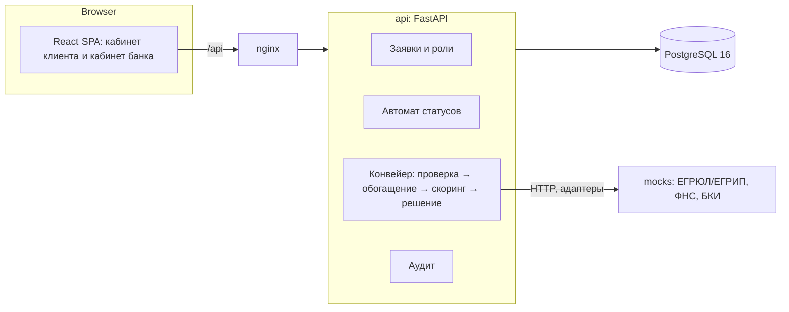

# Архитектура

Модульный монолит: один backend-сервис с чётко разделёнными модулями, веб-интерфейс и отдельный сервис моков.
Выбор сделан ради простого запуска на обычном ПК одной командой и простой проверки. Модули можно выносить в сервисы позже.

## Слои backend

| Слой | Файлы | Зависимости |
|---|---|---|
| Бизнес-ядро | `app/domain/*` | только стандартная библиотека Python, покрыто тестами |
| Сервисы | `app/services.py` | ядро, SQLAlchemy |
| API | `app/main.py`, `app/security.py` | FastAPI |
| Адаптеры источников | `app/adapters.py` | httpx |
| Хранилище | `app/models.py`, `app/db.py` | SQLAlchemy |

Бизнес-ядро не знает о базе и HTTP, поэтому скоринг и решение тестируются быстро и воспроизводимо.

## Конвейер обработки заявки

Запускается в фоне после отправки заявки (`BackgroundTasks`), безопасен для повторного запуска:

1. **Проверка** — полнота и корректность данных. Нет выручки или другого поля → «Нужны данные».
2. **Обогащение** — опрос ЕГРЮЛ/ЕГРИП, ФНС и БКИ через адаптеры. Таймаут повторяется (всего 3 попытки), затем источник считается недоступным.
3. **Скоринг** — 100 баллов по шести факторам, класс A–D, стоп-факторы.
4. **Решение** — одобрение, другие условия, ручной разбор или отказ. Недоступный источник ведёт в ручной разбор, а не к потере заявки.

Любой необработанный сбой переводит заявку в «Ручной разбор».

## Роли и доступ

| Роль | Может |
|---|---|
| `client` | создавать и менять свои заявки, отправлять, принимать оферту, подписывать, отзывать |
| `operator` | смотреть все заявки, запрашивать у клиента данные |
| `analyst` | то же, плюс принимать решение по заявкам в ручном разборе |
| `admin` | смотреть заявки, статистику и журнал аудита |

Аутентификация — JWT в заголовке `Authorization: Bearer`, пароли — PBKDF2-SHA256.

## Надёжность и масштабирование

- Смена статуса проходит через одну функцию с проверкой допустимости перехода.
- Повторная отправка уже отправленной заявки ничего не меняет.
- API не хранит состояние в памяти, поэтому масштабируется репликами за балансировщиком.
- Для нагрузки конвейер можно вынести в очередь задач и отдельный worker: граница уже выделена функцией `run_pipeline`.

## Что упрощено в прототипе

- Скоринг — правила без калибровки на реальных данных; веса и пороги — допущения.
- Внешние сервисы, подписание и выдача — моки.
- Файлы документов не хранятся, только метаданные.
- Фоновая обработка выполняется в процессе API, без отдельной очереди.
- Схема БД создаётся при старте, миграций нет.
- Автоматического истечения срока заявки нет.

## ИИ

Решение работает без ИИ. Кредитное решение принимает детерминированный скоринг. Если добавлять ассистента,
допускаются только модели с открытыми весами, запуск локально, без передачи персональных данных в промпт.
