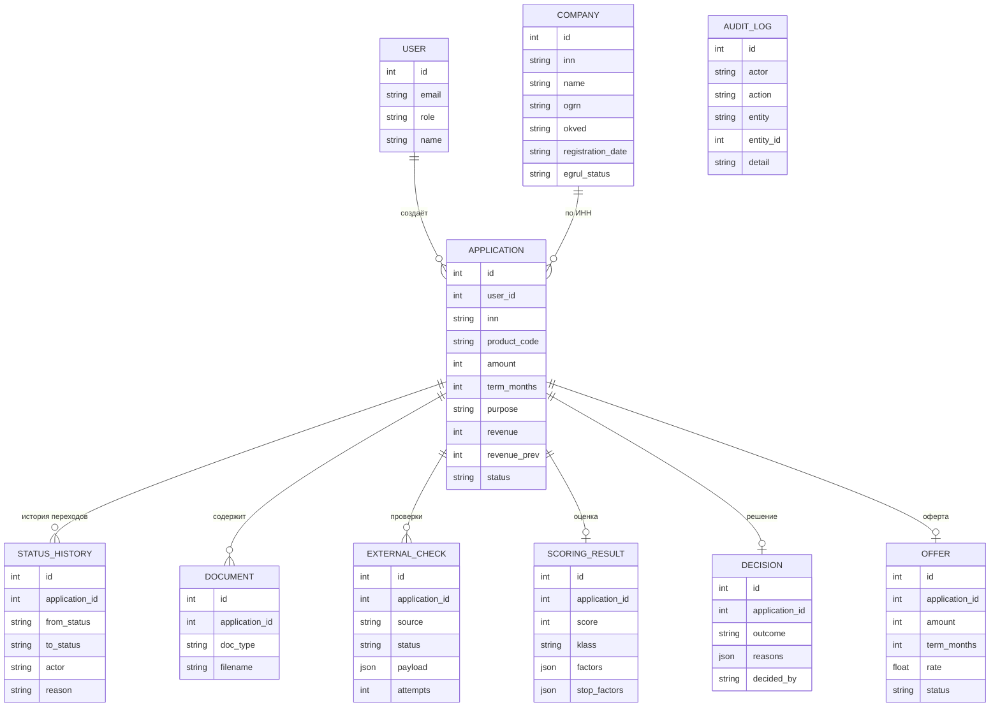

# Модель данных

Хранилище: PostgreSQL 16 (в Docker Compose) или SQLite (локальный запуск без Docker).
Таблицы создаются при старте API (`Base.metadata.create_all`). Заявка — центр модели.

Продукты не хранятся в БД: это конфигурация (`backend/app/domain/products.py`).
Пороги классов риска, премии к ставке и лимиты суммы — там же.

## Таблицы

- **users** — учётные записи; роль: `client`, `operator`, `analyst`, `admin`; пароль хранится как PBKDF2-хеш.
- **companies** — данные компании из ЕГРЮЛ/ЕГРИП (мок), создаются при обогащении.
- **applications** — заявка: продукт, сумма, срок, цель, выручка за два года, текущий статус, список недостающего.
- **status_history** — каждый переход: откуда, куда, кто, когда, причина.
- **documents** — метаданные приложенных документов (файлы не хранятся).
- **external_checks** — ответ каждого источника, статус (`ok`, `timeout`, `not_found`), число попыток.
- **scoring_results** — балл, класс, вклад каждого фактора и стоп-факторы.
- **decisions** — исход, причины, кто принял решение (`system` или почта аналитика).
- **offers** — условия оферты и статус принятия.
- **audit_log** — журнал действий: создание заявок, смены статусов.
