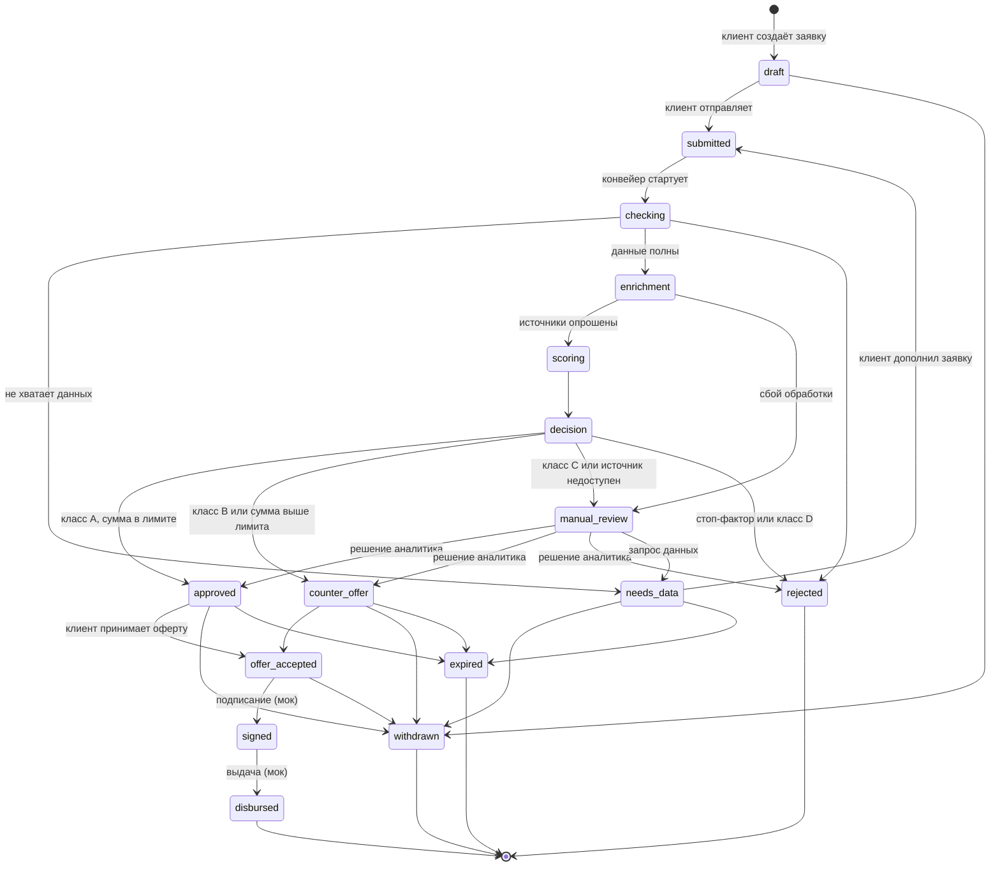

# Диаграмма состояний заявки

Статус меняется только через автомат переходов (`backend/app/domain/statemachine.py`).
Недопустимый переход возвращает ошибку 409. Каждый переход пишется в историю статусов и журнал аудита.

## Статусы

| Код | Название для клиента | Что означает |
|---|---|---|
| `draft` | Черновик | Заявка заполняется, банк её ещё не видит |
| `submitted` | Подана | Заявка отправлена, ждёт запуска конвейера |
| `checking` | Проверка | Проверка полноты и корректности данных |
| `enrichment` | Обогащение данных | Опрос ЕГРЮЛ/ЕГРИП, ФНС, БКИ |
| `scoring` | Скоринг | Расчёт балла и класса риска |
| `decision` | Решение | Применение кредитной логики |
| `approved` | Одобрена | Одобрение на запрошенных условиях |
| `counter_offer` | Другие условия | Банк предлагает иную сумму, срок или ставку |
| `needs_data` | Нужны данные | Клиент должен дополнить заявку |
| `manual_review` | Ручной разбор | Заявку рассматривает аналитик |
| `rejected` | Отказ | Отказ с причинами |
| `offer_accepted` | Оферта принята | Клиент принял условия |
| `signed` | Подписана (мок) | Договор подписан, операция моделируется |
| `disbursed` | Выдана (мок) | Деньги выданы, операция моделируется |
| `withdrawn` | Отозвана | Клиент отозвал заявку |
| `expired` | Истёк срок | Срок рассмотрения вышел |

Финальные статусы: `rejected`, `disbursed`, `withdrawn`, `expired`.

Статус `expired` в прототипе предусмотрен автоматом, но автоматического истечения срока нет.
